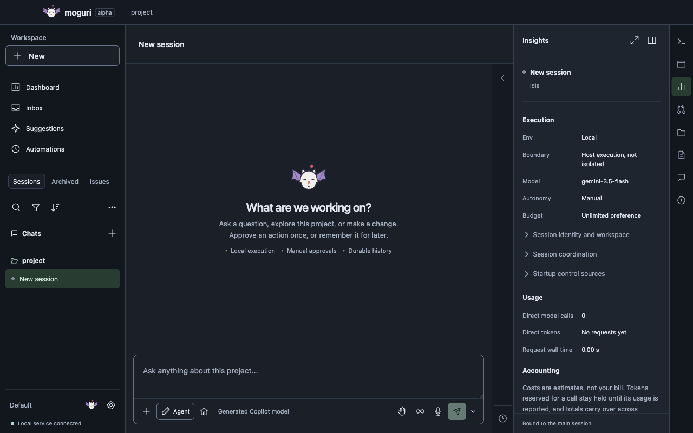
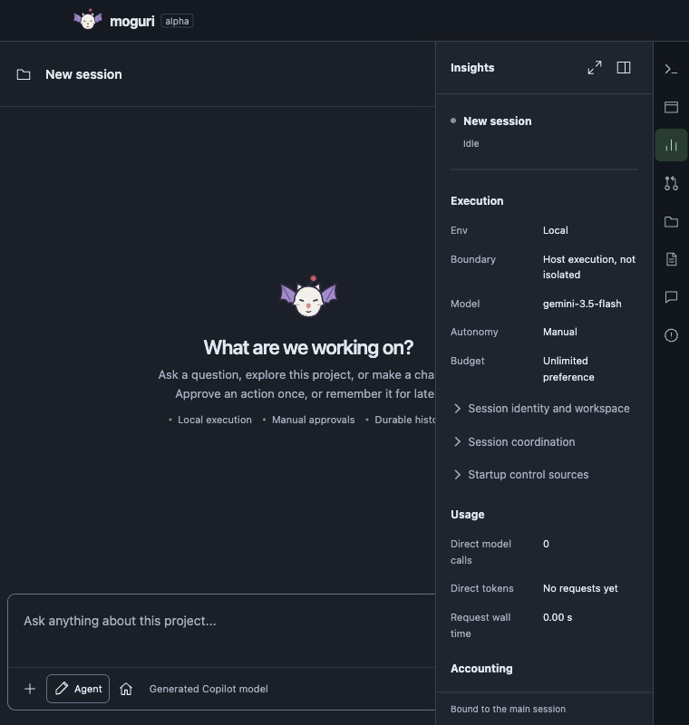
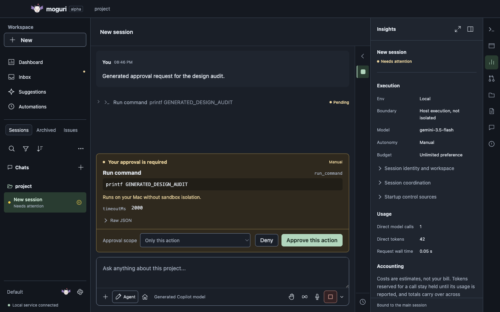
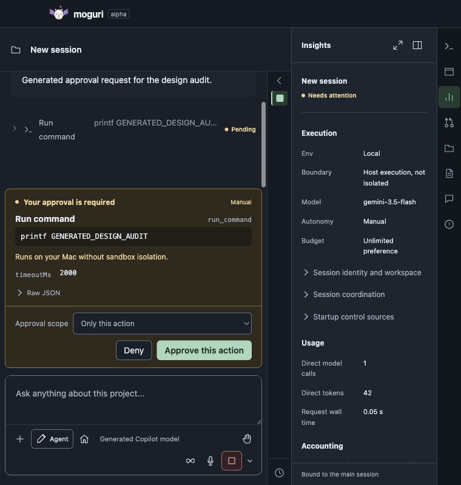
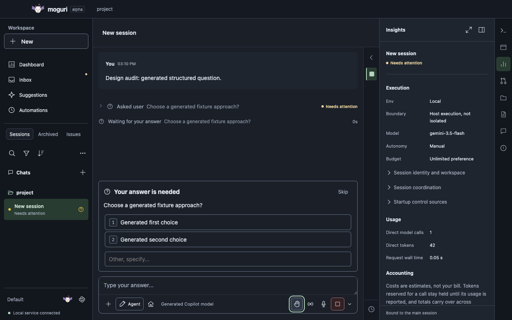
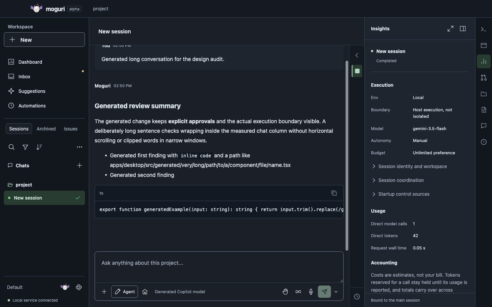
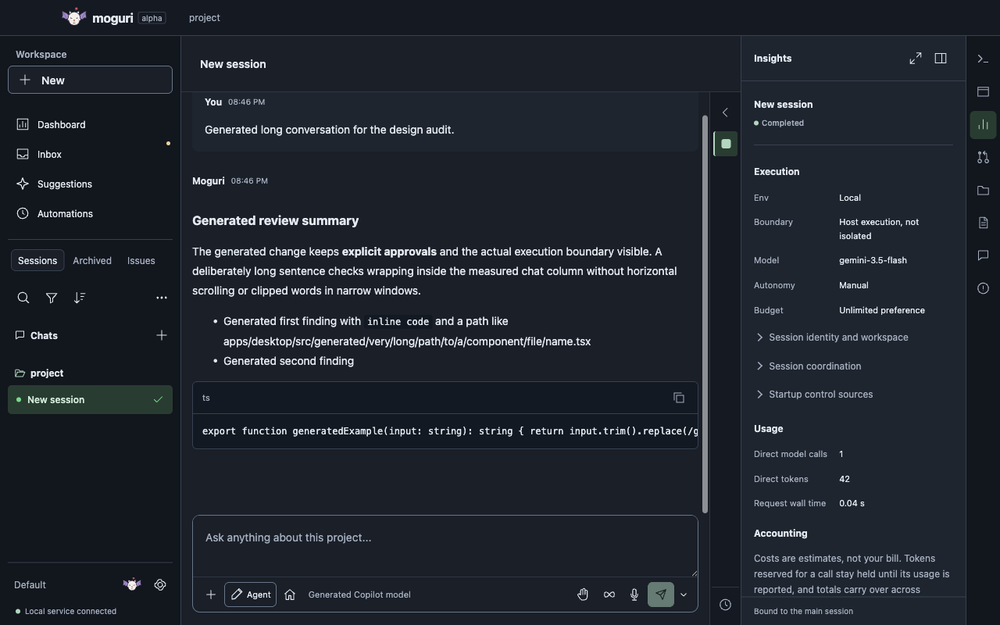
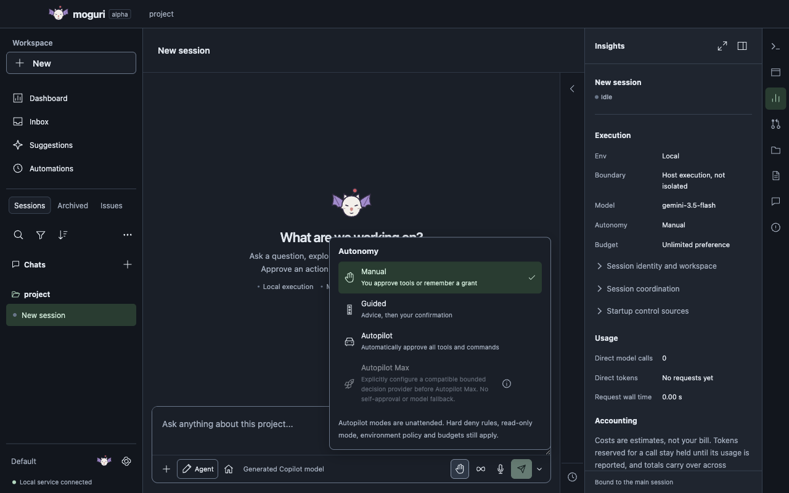

# Design audit and direction

This is the whole-app audit for [#53](https://github.com/mbianchidev/moguri/issues/53).
It separates what was observed from what changed, records the visual system it
produced and lists what remains. It is a UI quality pass on the development
alpha, not first-release acceptance, a human screen-reader audit or WCAG
certification.

## Method

- Source: `main` at `52f1752` (protocol 109, `0.32.0-alpha.1`), audited
  2026-11-17 on macOS arm64.
- Desktop: hidden Electron with generated fixtures only (no personal account,
  credentials or live inference), captured at 1280x800 and at a 760 CSS pixel
  viewport. The window minimum is 840px, so 760 is what a minimum window shows
  at about 110% zoom. `tests/e2e/design-captures.spec.ts` reproduces every
  screenshot below when `MOGURI_DESIGN_CAPTURE_DIR` and
  `MOGURI_DESIGN_CAPTURE_PREFIX` are set.
- TUI: the native OpenTUI test renderer with generated fixtures at 100x30 and
  52x24. `tests/tui-design-captures.test.ts` reproduces the frames when
  `MOGURI_TUI_CAPTURE_DIR` and `MOGURI_TUI_CAPTURE_PREFIX` are set.
- Stylesheet: a scan of `apps/desktop/src/styles.css` for raw values, undeclared
  variables, radii, shadows and font stacks, plus WCAG ratios computed for all
  ten presets in Dark and Light.

## What already worked

Earlier slices (#61, #62, #65, #66, #68, #70) left a solid base: a global 2px
focus ring, labeled icon buttons, 44px coarse-pointer targets, reduced-motion
rules for every looping animation, palette contrast checks for the main roles,
and session rows that pair a dot with an icon and an accessible label. The
audit kept all of that.

## Observed problems

| # | Observation | Evidence | Severity |
| --- | --- | --- | --- |
| O1 | At 760 CSS px and below the open side panel overlays the conversation and covers Approve, Deny and Send. A pending decision is hidden until the panel is closed. | `before-approval-760.png`; the new narrow test fails on `52f1752` with "760px covers Approve". | High |
| O2 | State words diverge: `waiting_input` (TUI list and state row), `Waiting Input` (Insights), `waiting input` (activity row), `Needs attention` (navigation) and raw lowercase outcomes (`partial`, `failed`). | `before-question-1280.png`, TUI frames below. | High |
| O3 | Two undeclared CSS variables, `--border` (8 uses) and `--panel` (1), silently dropped borders and a background on pinned sessions, bulk actions, interactive HTML, the PR pane and CI watch. | Stylesheet scan. | Medium |
| O4 | Styling was per slice: 56 raw hex values outside the palette, six overlay radii (5 to 10px), ten shadow values, five monospace stacks and no spacing, type, elevation or motion scale. | Stylesheet scan. | Medium |
| O5 | The CSS Light fallbacks had drifted from the SDK palette (control line, muted text, hover line), so first paint could differ from the runtime theme. | `appearanceColors()` versus `:root[data-theme="light"]`. | Low |
| O6 | Dark dialogs, the command palette and narrow drawers used shadows of 8 to 19% alpha, nearly invisible on slate. | Visual review. | Low |
| O7 | The connection line showed a failure-red dot while merely connecting. | `App.tsx` connection line. | Low |
| O8 | Partial results used the failure color in navigation; only the icon told them apart. | `.session-status-dot[data-session-state="partial"]`. | Low |
| O9 | A missing tool outcome read `result` in the TUI and was blank in the desktop Tool outputs header, rather than unknown. | `TuiMessage`, `App.tsx`. | Low |
| O10 | At 52x24 the TUI approval box shows only `{` of the arguments; the command needs Ctrl+V. | `before-tui-approval-52x24`. | Low |

## Direction

Keep the Operate-mode dark workbench: slate surfaces, quiet green action and
selection, system type. Polish comes from consistency, not decoration:

1. One token layer drives every surface; components never invent values.
2. Every state is a word from one shared vocabulary; color only reinforces it.
3. Pending decisions win the layout. Nothing overlays approvals, questions or
   the composer.
4. Unknown and partial outcomes stay visible and distinct from failure and
   success.
5. Desktop and TUI share words and state, not pixels.

## Prioritized changes

| Priority | Change | Status |
| --- | --- | --- |
| P1 | Narrow layout: from 760 to 561 CSS px the open side panel keeps its own column; at 560 and below it overlays, but approvals, questions and the composer stack above it (O1). | Done |
| P1 | Shared state vocabulary in `packages/protocol/src/status-labels.ts`, used by desktop `StatusBadge` (Insights, message outcomes, activity rows) and the TUI list, state row and outcomes (O2, O9). | Done |
| P1 | Token layer: palette roles, status roles, spacing, radius, type, targets, elevation, focus and motion, documented in [design.md](design.md#visual-system) (O4). | Done |
| P2 | Replace undeclared `--border`/`--panel` (O3); move every raw color into tokens (brand, terminal, chart lanes, swatch); unify overlay radii, shadows and the monospace stack (O4). | Done |
| P2 | Sync CSS fallbacks with the SDK palette (O5); deeper Dark dialog and drawer shadows (O6). | Done |
| P2 | Connection dot shows running while connecting (O7); partial uses its own status color (O8). | Done |
| P2 | Regression coverage: `tests/design-tokens.test.ts` and `tests/e2e/design-system.spec.ts`. | Done |
| P3 | TUI compact approval should show the command subject before raw JSON at 52x24 (O10). | Remaining |
| P3 | Convert the remaining per-component spacing and font sizes in long-tail Settings and analytics rules to scale tokens as those surfaces are next touched. | Remaining |
| P3 | Human screen-reader pass (VoiceOver) and a Light-theme visual review on a physical display. | Remaining |

## Before and after

All screenshots use generated fixtures. Before is `52f1752`; after is this
change.

| Screen | Before | After |
| --- | --- | --- |
| Start, 1280 |  |  |
| Start, 760 |  |  |
| Approval, 1280 |  |  |
| Approval, 760 |  |  |
| Question, 1280 |  |  |
| Question, 760 |  |  |
| Long conversation, 1280 |  |  |
| Long conversation, 760 |  |  |
| Composer popover |  |  |
| Settings / Appearance |  |  |

The 760 rows show the main fix: Approve, Deny and the composer are no longer
under the panel. The 1280 rows show the shared words (Needs attention, Pending,
Completed) in Insights and activity rows. Settings is intentionally unchanged.

### TUI, pending approval at 100x30

Before:

```text
 Chats                   │
 > ! New session         │  │ You
 project / waiting_input │  │ Generated approval request for the design audit.
                         │  run_command / requested
 ...
                         │  Env Local | Model gemini-3.5-flash
 /new  /sessions         │  Autonomy level Manual | Budget Unlimited
 /profiles  /sidebar     │  agent | waiting_input
```

After:

```text
 Chats                   │
 > ! New session         │  │ You
 Needs attention / proje │  │ Generated approval request for the design audit.
                         │  run_command / Pending
 ...
                         │  Env Local | Model gemini-3.5-flash
 /new  /sessions         │  Autonomy level Manual | Budget Unlimited
 /profiles  /sidebar     │  Agent | Needs attention
```

The state word now leads the session row, so a narrow sidebar clips the
project name instead of the state.

### TUI, Sessions tab and 52x24 state row

Before:

```text
                         │   ▶ ! New session
                         │     project / waiting_input / ID 3f204cfe-21d4-4701-b524-0cfd8f86e5ce

 Autonomy level Manual | Budget Unlimited
 agent | waiting_input
```

After:

```text
                         │   ▶ ! New session
                         │     project / Needs attention / ID 1f5e38b2-cde1-4e23-8af7-f50b381cbe69

 Autonomy level Manual | Budget Unlimited
 Agent | Needs attention
```

Session IDs differ because each capture uses a fresh generated fixture.

## Verification

- `tests/design-tokens.test.ts`: palette fallbacks equal the SDK palette; all
  documented scales exist with no circular references; every `var()` resolves
  or is set at runtime; raw colors appear only in the token blocks; status,
  focus and text contrast hold for every preset in Dark and Light; brand and
  chart tokens keep their own contrast; looping animations stop under reduced
  motion; every state maps to a declared status token.
- Measured minimums across ten presets and both modes: body text 11.03:1,
  secondary text 5.82:1, failed, attention, partial and unknown status text
  5.16:1, focus ring and status dots 3.08:1.
- `tests/e2e/design-system.spec.ts`: keyboard alone moves from the session row
  to the prompt, sends, reaches Approve, approves and reaches the code block,
  with a visible 2px focus ring at each stop and worded status in Insights and
  navigation. At 1280, 840, 760, 600 and 420 CSS px nothing overflows
  horizontally and Approve, Deny and the prompt are not covered.
- Existing desktop and TUI interaction suites keep the approval, question,
  composer, queue and navigation semantics.

## Remaining limitations

- No human screen-reader or physical-display audit was performed; ratios are
  computed from declared colors.
- Custom user colors are validated by the existing appearance checks, not by
  the new status-token checks.
- Long-tail Settings and analytics rules still contain literal spacing and font
  sizes; they read consistently but are not yet expressed in scale tokens.
- The TUI compact approval subject (O10) is unchanged.
- This pass does not change service, SDK capability or permission behavior and
  does not prove first-release readiness.
